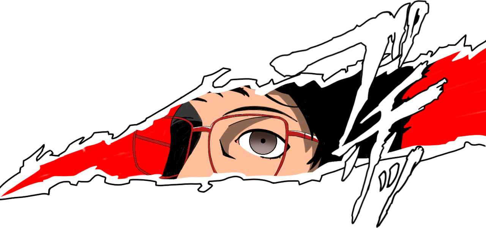

  

# Hello, I'm Mario!

> "I can do whatever I propose (of course with the correct time)."

**How to reach me:** mario.alberto.lira.zamora@gmail.com  
**Languages:** Spanish (Native) | English (B1)

I am a student of Information Technologies and Software Development.

---

### Technical Skills & Proficiency

| Frontend                                                | Backend                                             | Server & Tools                                         |
| :------------------------------------------------------ | :-------------------------------------------------- | :----------------------------------------------------- |
|       |   |      |
|   |   |       |
|     |   |         |
|     |    |  |
|  |  |     |
|                                                         |   |                                                        |
|                                                         |     |                                                        |

-  **Constant:** Constant use.
-  **Favorite:** I like that technology.
-  **Learning:** Learning.
-  **Touched:** Touched it and know the basics.
-  **Implemented:** Implemented in at least one real project.
-  **Deep experience:** Deep experience and track record solving problems.
-  **Archived:** Tool saved, know how to use it, but not in current use.

However, I understand that the choice of stack is depends of what I will work. For example, when choosing a database, it depends on whether the priority is read or write performance.

However, when I have to use other technology, I like to check and test it, before use in the main project. For example, when I worked in an ESB-service with C#, I had tested and used C# in mini codes.

I like using mockups to organize all items which I use in the screen before coding it.

---

### About Me & Preferences

| Preferences                                 | Hobbies                             |
| :------------------------------------------ | :---------------------------------- |
| I prefer Linux over Windows for coding      | Watching anime & reading manga      |
| I prefer red berry tea over coffee          | Playing video games                 |
| I love Docker (used in specific situations) | Learning & testing new technologies |

---

### Links

  
   
  
  <!--
   
  
  -->

